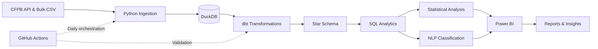

# Banking Complaint Intelligence System

[](https://github.com/AffanAmeer/cfpb-complaint-intelligence/actions/workflows/daily_pipeline.yml)

An end-to-end data engineering and analytics project built around the [CFPB Consumer Complaint Database](https://www.consumerfinance.gov/data-research/consumer-complaints/).

The project collects, processes, and analyses millions of consumer banking complaints to identify trends, understand recurring customer issues, compare company responses, and eventually detect unusual changes in complaint activity.

Rather than treating the dataset as a one-time analysis, I built a pipeline that continuously updates the data, validates it against the original source, and makes it available for downstream analytics.

**Status:** In progress. Data ingestion, warehouse modelling, automated validation, daily scheduling, and SQL-based KPI analysis are implemented. Statistical anomaly detection, NLP classification, and dashboard development are next.

## Project Highlights

| | |
|---|---|
| **19,028,339** | Consumer complaints loaded |
| **180** | Months of historical data reconciled |
| **57** | dbt tests passing |
| **11** | Standardized product categories |
| **8,199** | Consolidated companies |
| **Daily** | Automated pipeline refresh |
| **~7 sec** | Full dbt build on a MacBook Air |
| **~2 sec** | Execution time for all 7 KPI queries |

<sub>Dataset and warehouse figures reflect the November 9, 2026 snapshot. The warehouse grows every day as CFPB publishes new complaints, so older sections that describe a specific run give that run's numbers and date. Processing times are measured on my local machine and may vary by hardware.</sub>

## Architecture

The system follows a straightforward data engineering workflow, from raw data collection to analytical outputs.



**Tech stack**

- **Python:** Data ingestion, validation, transformation, and automation.
- **DuckDB:** Local analytical warehouse.
- **SQL:** Data exploration, KPI calculations, and analytical queries.
- **dbt Core:** Data modelling, documentation, and automated testing.
- **GitHub Actions:** Scheduled pipeline execution and warehouse persistence.
- **scikit-learn:** Planned statistical and NLP modelling.
- **Power BI:** Planned interactive dashboards and reporting.

## 1. Data Ingestion & Validation

The dataset contains over 19 million complaints dating back to December 2011. Downloading the entire history through the API would require approximately 190,000 requests at 100 records per request.

Instead, I use two ingestion methods:

**Historical backfill: `load_bulk.py`**

The CFPB provides a downloadable bulk file containing the historical dataset. This is used to populate the warehouse initially, and the daily pipeline merges it again on every run.

The loader:
- Unzips the bulk file (a 5.7 GB CSV).
- Validates row counts, duplicate complaint IDs, and unparseable dates.
- Loads the data into DuckDB.
- Uses `MERGE` on `complaint_id` to prevent duplicate records.

The initial bulk load takes under a minute on my machine.

**Incremental updates: `load_api.py`**

The API handles ongoing updates and changes to existing complaints.

Every run:
- Retrieves the previous seven days of complaints.
- Uses `search_after` pagination to retrieve all matching records.
- Checks the number of retrieved records against the API's daily counts.
- Upserts records using `complaint_id`.
- Only overwrites existing records when the incoming data is at least as recent.

The seven-day lookback is important because complaints can change after their initial publication. For example, a complaint marked "In progress" may later become "Closed with explanation."

**Reconciliation: `reconcile.py`**

Rather than assuming a successful ingestion means accurate data, I built a separate reconciliation process against the CFPB API.

It runs five checks:
- No duplicate complaint IDs.
- Every complaint date falls in a valid range.
- The total complaint count matches the API.
- Every month's count matches the API.
- Each of the last 14 days matches the API.

The initial reconciliation passed all five checks, with all 180 historical months matching.

### Handling late-arriving data

One issue became apparent during the first scheduled pipeline runs: the CFPB continues publishing complaints for dates several weeks in the past.

A seven-day API lookback alone was not sufficient. The warehouse was approximately 8,400 complaints short, with most missing records concentrated in late October.

To address this, I changed the daily pipeline to merge the latest full bulk dataset before applying the API updates. This also removes complaints the CFPB has taken out of the source.

The bulk file is only produced once a day, so a few complaints can still be published after it is made. Reconciliation therefore allows a small, stated gap (a warning, not a failure) only for recent days: within the last 120 days and outside the seven days the API reloads. Everything else must match exactly. The first run after the fix (November 10, 2026) matched the API exactly: 19,028,339 complaints, all five checks passing.

This was an important part of making the pipeline reliable rather than simply making it run.

## 2. Data Warehouse & Modelling

I used dbt to transform the raw complaint table into a star schema inside DuckDB.

The warehouse has three layers:

| Layer | Model | Description |
|---|---|---|
| Staging | `stg_complaints` | Standardized complaint records and cleaned fields |
| Marts | `fact_complaints` | Central fact table containing complaint-level records |
| Marts | Dimension tables | Product, issue, company, state, and date |
| Reference | CSV seeds | Manually reviewed mappings for inconsistent source categories |

**Fact and dimension tables**

- `fact_complaints`
- `dim_product`
- `dim_issue`
- `dim_company`
- `dim_state`
- `dim_date`

The fact table has exactly one row per raw complaint: 19,028,339 rows in the November 9, 2026 snapshot.

### Modelling decisions

A few characteristics of the original dataset required additional work.

**Product category standardization**

The CFPB changed its product classification system twice, resulting in 21 historical product names across three naming schemes.

This makes year-over-year comparisons difficult without standardization.

I created `product_group_map.csv` to map historical product names to the CFPB's current 11 product categories. Where a category was split into multiple products, the mapping also considers the sub-product.

This allows product trends to be compared consistently across the full historical dataset.

**Company name standardization**

The source contains multiple spellings of the same company, often differing only in capitalization, whitespace, or punctuation.

I standardized these variations, reducing 8,211 source spellings to 8,199 company records (November 9, 2026 snapshot).

Different legal entities are kept separate rather than being incorrectly combined under the same parent organization.

**Credit bureau separation**

Equifax, TransUnion, and Experian account for most complaints: about 88% in the last 12 complete months.

I added an `is_credit_bureau` flag to the company dimension so that analyses can distinguish credit bureau activity from other financial institutions.

Without this separation, changes in credit reporting complaints can obscure trends across banks and other financial companies.

**Stable keys**

Dimension keys use MD5 hashes of their natural values, allowing keys to remain consistent between pipeline runs.

Date keys use the integer `YYYYMMDD` format.

### Data quality

The dbt project currently has 57 passing tests, covering:

- Unique and non-null primary keys.
- Valid foreign key relationships.
- Accepted values for categorical fields.
- One fact record per raw complaint.
- Complete product mapping coverage.
- Unit tests for product mapping and company name standardization.

I also configured source freshness checks to flag when the raw data has not been updated within two days.

## 3. Daily Pipeline Automation

The entire pipeline runs automatically through GitHub Actions.

`.github/workflows/daily_pipeline.yml` schedules a daily execution at 18:37 UTC, after the CFPB's daily update.

The workflow:

1. Checks that the CFPB API and bulk dataset are reachable.
2. Downloads the previously saved warehouse.
3. Merges the latest bulk dataset.
4. Retrieves recent changes through the API.
5. Reconciles the warehouse against the source.
6. Runs `dbt build` and source freshness checks.
7. Saves the updated DuckDB warehouse.
8. Generates a run summary and retains logs for 30 days.

### Keeping the warehouse between runs

GitHub Actions runners are temporary, so the DuckDB database would otherwise disappear after each execution.

I solved this by compressing the warehouse and storing it as an asset in a GitHub Release. Each run that passes `dbt build` replaces the previous warehouse, making the latest database available for download.

The pipeline also handles a missing warehouse by rebuilding the historical dataset from the bulk CSV.

**Additional reliability measures:**

- A concurrency group prevents overlapping pipeline runs.
- GitHub's temporary workflow token is used for release permissions, avoiding a separately managed personal access token.
- Reconciliation failures preserve the newly ingested warehouse before marking the workflow as failed.
- Failed dbt builds do not publish an updated warehouse.

### First full run

The first complete pipeline execution on November 7, 2026, took 23 minutes and 48 seconds.

| Stage | Execution time |
|---|---:|
| Historical bulk load | 55 sec |
| API ingestion | 16 min 20 sec |
| Reconciliation | 4 min 22 sec |
| dbt build | 52 sec |
| Total pipeline | 23 min 48 sec |

That run loaded all 18,965,764 complaints that existed at the time into the fact table and passed all five reconciliation checks. The total has grown since then as the CFPB publishes new and late complaints.

## 4. SQL Analysis & KPIs

With the warehouse in place, I built a set of SQL queries to turn the complaint data into measurable business insights.

All seven analytical queries execute in approximately two seconds against the 19-million-record dataset.

Results are exported as CSV files to `reports/kpis/`, with definitions documented in [docs/kpi_definitions.md](docs/kpi_definitions.md) and findings summarized in [docs/analysis_findings.md](docs/analysis_findings.md).

| Query | Analysis |
|---|---|
| `_window.sql` | Sets the reporting window (the last 12 complete months and the 12 before), shared by every query |
| `00_data_maturity.sql` | Evaluates data completeness and publication delays |
| `01_headline_kpis.sql` | Overall complaint volume, bureau share, timely responses, and monetary relief |
| `02_monthly_trend.sql` | Historical trends, monthly changes, YoY growth, and rolling averages |
| `03_product_yoy.sql` | Year-over-year complaint trends by product |
| `04_top_companies.sql` | Highest-volume companies, ranked separately for credit bureaus and other companies |
| `05_top_issues_by_product.sql` | Most common complaint issues within each product |
| `06_company_response_scorecard.sql` | Company response metrics for institutions with at least 1,000 complaints |

### Analytical decisions

Some choices were particularly important for producing meaningful comparisons.

**Data maturity**

The newest complaint periods are incomplete because the CFPB publishes most complaints only after the company responds, which can take up to 15 days. In the November 9 snapshot, non-bureau complaints in the week of October 26 were at 46% of a normal week.

I exclude incomplete months and only include a month once it has ended at least 30 days before the latest complaint date.

**Separate reporting for credit bureaus**

Credit bureaus are reported separately from other financial companies to avoid having their complaint volumes dominate the analysis.

**Closed complaints for response metrics**

Timely response and monetary relief rates are calculated using closed complaints. Complaints still in progress are not treated as completed responses.

**Percentage changes vs. percentage-point changes**

Changes in complaint counts are expressed as percentages, while changes in response and relief rates are expressed in percentage points.

**Complaint volume is not a measure of company quality**

A large institution will naturally receive more complaints than a smaller one. Without customer counts or account-level exposure data, raw complaint volume cannot establish which company has the worst complaint rate.

## 5. Initial Findings

The following findings are based on the November 9, 2026 snapshot.

The current reporting period is October 2025 to September 2026, compared with the preceding 12 months.

### Complaint volumes are increasing, but growth is slowing

Total complaints increased by 46.0%, from 4,800,962 to 7,010,093.

However, much of this increase came from Equifax, TransUnion, and Experian.

Excluding those companies, complaints increased by 23.1%, from 699,858 to 861,811.

The growth rate in non-bureau complaints also slowed considerably, falling from 68.8% year-over-year in December 2025 to 11.5% in September 2026.

### Debt collection has become the largest non-bureau product

Debt collection accounts for 292,812 complaints, representing 34.0% of all non-bureau complaints.

Its most common issue is "Attempts to collect debt not owed," accounting for 43.3% of debt collection complaints.

### Timely response rates provide limited differentiation

99.55% of closed complaints received a timely response.

Because the overall rate is so high, it provides limited differentiation between most companies.

However, there are notable exceptions. MOHELA responded on time to only 27.76% of its 8,551 closed complaints.

### Monetary relief varies across companies

The monetary relief rate for non-bureau companies increased from 3.58% to 3.92% of closed complaints.

There are also substantial differences between large financial institutions. Bank of America had a monetary relief rate of 24.81%, compared with 5.68% for Capital One.

These figures should be interpreted carefully because companies have different product and complaint mixes.

*These results are descriptive, not causal. Complaints come from people who chose to file one, so they do not represent all customers.*

## 6. Running the Project

### Requirements

- Python 3.12
- Git

DuckDB, dbt Core and dbt-duckdb are installed from `requirements.txt`.

### Installation

Clone the repository:

```bash
git clone https://github.com/AffanAmeer/cfpb-complaint-intelligence.git
cd cfpb-complaint-intelligence
```

Create a virtual environment:

```bash
python3.12 -m venv .venv
source .venv/bin/activate
```

Install dependencies:

```bash
python -m pip install -r requirements.txt
```

### Load the data

```bash
curl -L -o data/raw/complaints.csv.zip \
  https://files.consumerfinance.gov/ccdb/complaints.csv.zip

python src/ingestion/load_bulk.py
python src/ingestion/load_api.py
python src/ingestion/reconcile.py
```

### Build the warehouse

```bash
cd dbt

dbt build
dbt source freshness
```

### Run the KPI analysis

```bash
cd ..

python src/analysis/run_kpis.py
```

Each query result is saved as a CSV in `reports/kpis/`.

Alternatively, download the latest compressed warehouse from the project's [`warehouse` release](https://github.com/AffanAmeer/cfpb-complaint-intelligence/releases/tag/warehouse), extract it with `gunzip`, and place it at:

```text
data/warehouse/complaints.duckdb
```

This allows you to explore the warehouse and run the analytical queries without downloading the entire historical dataset again.

## 7. Roadmap

The project is being developed in stages, with the goal of moving from descriptive analytics towards automated detection and classification.

- [x] Explore the CFPB dataset and API
- [x] Historical bulk ingestion
- [x] Incremental API ingestion
- [x] Data reconciliation and validation
- [x] dbt star schema and automated tests
- [x] Daily GitHub Actions pipeline
- [x] SQL-based KPI analysis
- [ ] Statistical anomaly detection and complaint spike identification
- [ ] NLP-based complaint classification
- [ ] Interactive Power BI dashboard
- [ ] Automated monthly analytical brief
- [ ] Presentation deck and Excel exports
- [ ] Port the warehouse to Databricks
- [ ] Final architecture diagram and technical documentation

## Data Source & Limitations

**Source:** [Consumer Financial Protection Bureau (CFPB) Consumer Complaint Database](https://www.consumerfinance.gov/data-research/consumer-complaints/)

The database contains complaints submitted by consumers about financial products and services in the United States.

A few limitations are important:

- Complaints are not a representative sample of all consumers.
- The number of complaints does not account for company size or customer base.
- The CFPB stopped publishing consumer complaint narratives in September 2026, so the current data has no complaint text.
- Complaint records can be updated or removed after their initial publication.
- Recent periods may be incomplete due to publication delays.

The ingestion, modelling, and analytical methods developed here could also be adapted to complaint datasets from Canadian financial institutions.

---

**Built by Affan Ameer**

[GitHub](https://github.com/AffanAmeer)
