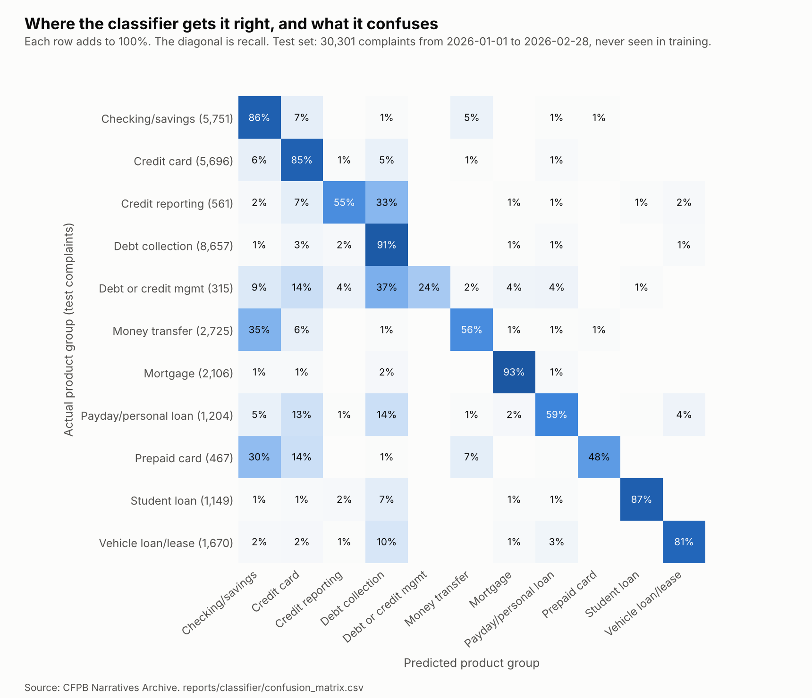
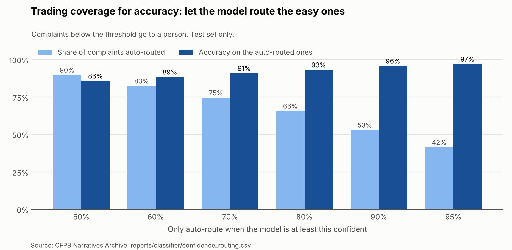

# Complaint Classifier

Read a complaint's narrative and predict which product group it belongs to (Credit card, Mortgage, Debt collection, and the rest of the 11 groups the warehouse uses).

At a bank, this is the first step of routing complaints. Consumers choose a product on the CFPB form, but complaints that come in by email, chat or phone have no label at all. Someone has to read each one and send it to the right team.

All numbers come from `reports/classifier/`. The code is in `src/classifier/`.

## Where the text comes from

In August 2026 the CFPB stopped publishing complaint narratives. The bulk file our warehouse loads no longer has a narrative column. The narratives that were already public are kept in the CFPB's [Narratives Archive](https://www.consumerfinance.gov/foia-requests/foia-electronic-reading-room/cfpb-consumer-complaint-database-narratives-archive/) in its FOIA Reading Room: 21 zip files covering complaints received from December 2011 to August 14, 2026.

I used 7 of them, covering complaints received from January 2025 to February 2026: **1,255,993 narratives** after cleaning. Personal details are already scrubbed by the CFPB (names and dates appear as `XXXX`, amounts as `{$40.00}`).

## Method

**Split by date, not at random.** I trained on 2025 and tested on January and February 2026. A model in production only ever sees the past, so it should be tested the same way. Settings were chosen on November and December 2025 (with the model trained on January to October), so the test months were used only once, at the end.

**Repeated texts.** Only 653,205 of the 1.26 million narratives are unique. Many are form letters, mostly to the three credit bureaus. In training I keep one copy of each text (546,683 left from 2025). In testing I drop the 496 texts that appear word for word in training, so the model can't pass by memorising. That leaves **30,301 test complaints**.

**Text cleaning.** Lowercase, drop the `XXXX` redaction marks, replace amounts with one token (`dollaramount`), keep letters only.

**Model.** TF-IDF on single words and two-word phrases (300,000 features, phrases in at least 5 complaints, sublinear term frequency), then multinomial logistic regression. I tried 6 settings (regularisation C = 1, 4 or 16, with and without balanced class weights) on the validation months. C = 4 without class weights had the best macro F1 (0.724). The 6 settings were all between 0.711 and 0.724, so the choice matters little.

**Baselines.** A model is only worth it if it clearly beats simple rules:

- always guess the most common group in training
- a hand-written keyword rule set (e.g. "escrow" or "foreclosure" means Mortgage, "Zelle" or "Cash App" means Money transfer), the kind of thing a team might set up before any model

## The product mix changed between 2025 and 2026

Credit reporting was **54.9%** of the 2025 training narratives but only **1.85%** of the test narratives. Monthly narrative counts for credit reporting went from 39,000 to 101,000 a month in 2025 to 862 in January 2026. The archive doesn't say why. The full database still has plenty of credit reporting complaints, so this is about which complaints were published with their text, not about fewer complaints.

A model learns how common each group was in training. Trained on 2025, it leans towards credit reporting: on the test months it labelled far too many complaints as credit reporting (precision 0.14).

**The fix: re-estimate the new mix without labels.** This is a known problem called label shift. I used the EM method from Saerens, Latinne and Decaestecker (2002). Start with the training mix. Rescale every predicted probability by new share / training share. Average the rescaled probabilities to get a new estimate of the mix. Repeat until it stops changing. It uses only the model's own predictions on the new complaints, never their labels, so a bank could run it on a new month before anyone has labelled it.

It estimated credit reporting at 2.35% of the test months (actual: 1.85%), and every group's estimate was within 2.5 points of the truth (`mix_adjustment.csv`).

## Results (test: January and February 2026, 30,301 complaints)

| Model | Accuracy | Macro F1 | Weighted F1 |
| --- | ---: | ---: | ---: |
| Always the most common group | 1.9% | 0.003 | 0.001 |
| Keyword rules | 41.3% | 0.457 | 0.472 |
| TF-IDF + logistic regression | 75.5% | 0.682 | 0.784 |
| **TF-IDF + logistic regression, adjusted for new mix** | **81.7%** | **0.724** | **0.812** |

The "most common group" baseline is so low because the most common group in training (credit reporting) is rare in the test months. That is the mix shift again.

The model beats the keyword rules by 40 points of accuracy. Correcting for the new mix adds another 6 points.

**By product group** (adjusted model, `classification_report.csv`):

| Product group | Precision | Recall | F1 | Test complaints |
| --- | ---: | ---: | ---: | ---: |
| Mortgage | 0.93 | 0.93 | 0.93 | 2,106 |
| Student loan | 0.96 | 0.87 | 0.91 | 1,149 |
| Debt collection | 0.87 | 0.91 | 0.89 | 8,657 |
| Vehicle loan/lease | 0.87 | 0.81 | 0.84 | 1,670 |
| Credit card | 0.80 | 0.85 | 0.82 | 5,696 |
| Checking/savings | 0.74 | 0.86 | 0.80 | 5,751 |
| Money transfer | 0.80 | 0.56 | 0.65 | 2,725 |
| Payday/personal loan | 0.68 | 0.59 | 0.63 | 1,204 |
| Prepaid card | 0.73 | 0.48 | 0.58 | 467 |
| Credit reporting | 0.52 | 0.55 | 0.53 | 561 |
| Debt or credit mgmt | 0.84 | 0.24 | 0.37 | 315 |

**What it gets wrong** (`confusion_matrix.csv`). The biggest mistake is money transfer complaints labelled as checking/savings (953 of 2,725). That makes sense: a Zelle or Cash App problem is often a problem with a bank account too, and a consumer could fairly pick either product. Next are checking/savings and credit card mixed up with each other (374 and 347), and credit card complaints labelled as debt collection (309), often about a card debt that went to collections. Debt or credit management (debt relief and credit repair companies) is the weakest group: small, and its complaints read like debt collection or credit reporting complaints.



**The phrases it relies on** (`top_terms.csv`) are sensible and mostly product words and company names: "mortgage", "escrow", "heloc" for mortgages; "mohela", "nelnet", "aidvantage" for student loans; "zelle", "paypal", "cashapp", "coinbase" for money transfers; "experian", "equifax", "transunion" for credit reporting.

## Using it: auto-route the confident ones

A bank wouldn't let a model route every complaint. A safer setup: the model routes the complaints it is confident about, and a person reads the rest (`confidence_routing.csv`).

| Auto-route when confidence is at least | Share auto-routed | Accuracy on those |
| ---: | ---: | ---: |
| 50% | 89.9% | 86.0% |
| 70% | 74.7% | 91.1% |
| 80% | 65.8% | 93.3% |
| 90% | 53.1% | 95.9% |
| 95% | 41.6% | 97.2% |

At a 90% threshold, the model routes about half of the complaints with 95.9% accuracy, and people read the other half. The threshold is a business choice: how many mistakes you accept against how much reading you save.



## Limitations

- **The labels are the consumer's own choice** on the CFPB form, not an expert's. Some "mistakes" (money transfer vs checking) are complaints that honestly fit both.
- **Narratives are opt-in.** Only consumers who agreed to publish their story are included, and the mix of published narratives changed sharply in 2026. The model may behave differently on complaints that would never have been published.
- **The mix correction assumes only the mix changed**, not how people describe each product. Over a couple of months that is reasonable; over years it isn't, and the model would need retraining.
- **Two test months.** The CFPB stopped publishing narratives after August 2026, and the archive's newest months are small, so there is no later period to test on.
- **U.S. data.** The same approach would work on a Canadian bank's own complaint text, but the model itself would need retraining on it.

## How to run it

Download the archive files into `data/raw/narratives/` (see the README), then:

```bash
python src/classifier/load_narratives.py
python src/classifier/train_classifier.py
python src/classifier/plot_classifier.py
```

Loading takes under a minute. Training is the slow part: tuning fits 6 models on 476,725 complaints (January to October 2025) and scores them on 69,958 (November and December). Each fit took 9 to 15 minutes in my run, then the final model takes about as long again. To skip tuning and reuse the winning settings from `tuning_validation.csv`:

```bash
python src/classifier/train_classifier.py --skip-tuning
```

The trained model is saved to `data/models/product_classifier.joblib` (not in Git).
