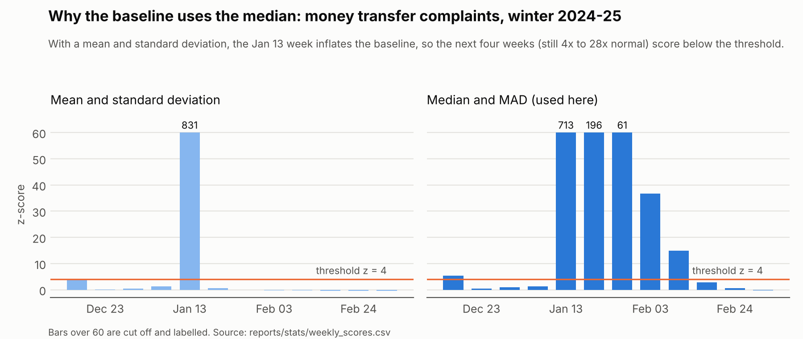
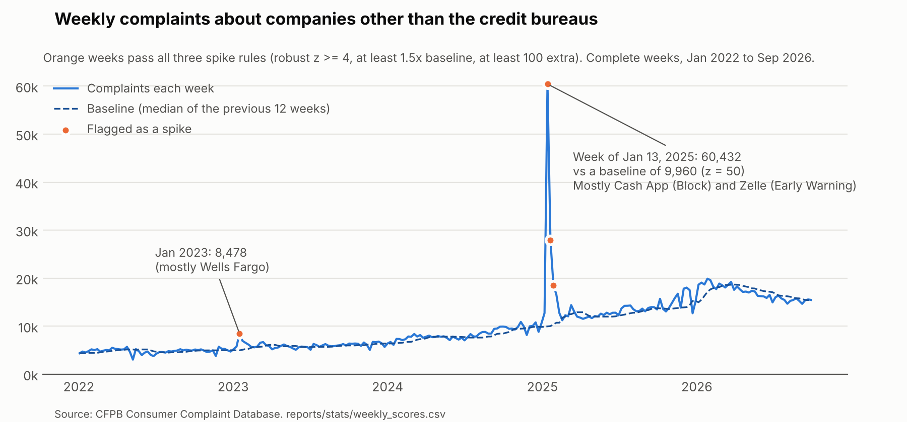

# Spike Detection (Phase 6: Statistics)

**Data as of 2026-11-09** (19,028,339 complaints in the warehouse). The tests use complete weeks only, from the week of 2014-08-04 to the week of 2026-09-28: 635 weeks and 17,961,134 complaints (the first 12 weeks of each series only serve as a baseline).

Every number here comes from the CSVs in `reports/stats/`, produced by:

```bash
python src/stats/run_spike_detection.py
python src/stats/significance_tests.py
python src/stats/plot_spikes.py
```

The whole run takes about 15 seconds. Like the KPIs, the results are a snapshot: CFPB keeps updating old complaints, so a later run can differ slightly.

This is U.S. data. Complaint counts show what people chose to report, not how often problems happen.

## The question

When does a company or product get far more complaints than usual, and is the jump real or just noise? A bank would want to know that the week it happens, not at the end of the quarter.

## What gets tested

41 weekly series, each scored separately:

| Level | Series |
| --- | --- |
| Overall | All non-bureau companies; the three credit bureaus together |
| Product | Each of the 11 product groups, non-bureau companies only |
| Company | The 25 biggest non-bureau companies (last 104 weeks), and Equifax, Experian and TransUnion on their own |

The bureaus are kept apart for the same reason as in the KPIs: they are about 88% of complaints and would drown out everything else.

**Why weeks.** Days swing with the day of the week (a Sunday has about 40% of a Tuesday's complaints). Months give only 12 points a year. A week holds every weekday once, so the weekday pattern cancels out.

**Why only complete weeks.** CFPB publishes a complaint after the company answers, so the newest weeks are always short (see `00_data_maturity.csv`). A week is used only once it ended at least 30 days before the newest complaint, the same rule as the KPIs. The cost: this can't alert on the last month. A live alert would need a correction for the publishing lag.

**Why from August 2014.** CFPB added product types until July 2014 (debt collection in July 2013, prepaid cards in July 2014). Before that, jumps are new products, not spikes.

## Method 1: robust rolling z-score (the detector)

For each week:

```
baseline = median of the previous 12 weeks
spread   = MAD of the previous 12 weeks x 1.4826   (never below sqrt(baseline))
z        = (this week - baseline) / spread
```

A week is a **spike** when all three hold:

| Rule | Why |
| --- | --- |
| z >= 4 | Statistically unusual for this series. We test about 24,000 weeks, so a low bar would flag hundreds of weeks by chance. |
| At least 1.5x the baseline | Big enough to matter to a business (practical significance, not just statistical). |
| At least 100 extra complaints | Stops tiny series from flagging on a handful of complaints. |

Neighbouring spike weeks (at most one quiet week apart) are joined into one **episode**, because a burst and its tail are one event.

### Why not a Poisson test

The project brief suggested a Poisson test. A Poisson count has variance equal to its mean. These counts don't (`method_checks.csv`):

| Series | Variance / mean in the 12-week baselines | Weeks a Poisson test calls significant (p < 0.001) |
| --- | ---: | ---: |
| All non-bureau companies | 26.1 | 211 of 623 |
| All credit bureaus | 42.0 | 336 of 623 |
| Biggest non-bureau companies | 1.3 to 3.4 | 13 to 71 per company |

A test that calls a third of all weeks "significant at 0.1%" is not a spike detector. Complaints are **overdispersed**: people complain in waves (news, outages, viral posts), not independently. The z-score fixes this by measuring the spread from the data itself instead of assuming it.

### Why median and MAD, not mean and standard deviation

A huge week pulls up the mean and the standard deviation of every baseline it is in, for the next 12 weeks. The weeks right after a spike then look normal even when they are not. This is called **masking**.

Money transfer complaints, winter 2024-25 (`jan2025_validation.csv`):

| Week | Complaints | Baseline (median) | Robust z | Mean/SD z |
| --- | ---: | ---: | ---: | ---: |
| Jan 6 | 411 | 351 | 1.4 | 1.4 |
| **Jan 13** | **36,311** | 358 | 713.2 | 831.2 |
| Jan 20 | 10,268 | 366 | 196.4 | **0.7** |
| Jan 27 | 3,197 | 373 | 61.5 | **-0.1** |
| Feb 3 | 2,151 | 384 | 36.7 | **-0.2** |
| Feb 10 | 1,574 | 401 | 14.9 | **-0.3** |

Jan 20 had 28 times the normal volume and the mean/SD version scores it 0.7. The median version keeps flagging until the tail is over.



### Results

**101 spike episodes** in 35 of the 41 series (202 spike weeks out of about 24,000 tested): 8 in the overall series, 36 in product groups, 57 in companies (`spike_episodes.csv`).

The threshold is a judgment call, and the count falls smoothly as it rises, with no obvious "elbow" (`threshold_sensitivity.csv`):

| z threshold | 3 | **4** | 5 | 6 | 8 |
| --- | ---: | ---: | ---: | ---: | ---: |
| Episodes | 111 | **101** | 93 | 81 | 59 |

The large events below are found at every one of these thresholds. What changes is how many small ones get through.



## Method 2: seasonal decomposition (STL), the second opinion

A 12-week baseline has a blind spot: the calendar. STL splits each series (on a log scale) into a slow **trend**, a **seasonal** pattern that repeats every 52 weeks, and a **residual**. A spike should still stand out in the residual.

**Seasonality is real but moderate.** Seasonal strength (0 = none, 1 = all seasonal) is 0.34 for all non-bureau complaints, 0.20 for the bureaus, and 0.00 to 0.54 by product (mortgage is the most seasonal). For non-bureau companies, February and March run about 7% to 9% above trend and December about 10% below (one-off check of the STL seasonal part, averaged by month).

That matters for a 12-week baseline: a January week is compared against November and December, the quietest weeks of the year, so it looks higher than it is.

**Result:** 77 of the 101 episodes are confirmed by STL (residual z >= 3). The other 24 are worth a second look rather than being wrong. Two kinds stand out:

- **Calendar effects.** The three bureaus together flag the week of Jan 3, 2022 (z = 4.2), but STL scores it 1.2: it is the first week back after the holidays, against a holiday baseline.
- **Long episodes.** TransUnion was about 3x its baseline from late November 2021 to early January 2022. STL treats six weeks of that as part of the trend, not a spike.

**Limits, stated plainly.** STL looks at weeks on both sides, so it can only check a spike after the fact; the z-score is the one that could run as a weekly alert. And STL's answer depends on its settings: with a longer seasonal window (13 instead of statsmodels' default 7), 13 of the 101 episodes switch between confirmed and not. So STL is used as a second opinion, not a verdict.

## Method 3: change-point detection (tested, left out)

The plan was to add change-point detection only if it found shifts the first two methods missed. It was tested with PELT (the `ruptures` library) on log weekly counts, raw and seasonally adjusted, in a one-off check that is not part of the repo code.

It was left out because:

- It mostly redraws a steadily rising series as a staircase. On all non-bureau complaints it found 14 "shifts" with one penalty and 7 with another, on the same data. The answer depended on a setting more than on the data.
- The sharp changes it did find (January 2025, for example) are the spikes the z-score already catches. The slow growth it found is already shown by the STL trend and by the year-over-year KPIs.

Leaving a method out because it didn't add anything is a result too.

## Validation

There are no official labels saying which weeks were "real" spikes, so precision and recall can't be measured. Instead, the detector was checked against events that are publicly known. It flagged every one, in the right week, with the right company as the main driver:

| Event (public date) | What the detector found |
| --- | --- |
| Wells Fargo fake-accounts settlement (Sep 8, 2016) | Wells Fargo, weeks of Sep 5 to Oct 3, 2016; peak 451 vs a baseline of 190. Checking/savings flagged on Sep 19. |
| CFPB sues Navient (Jan 18, 2017) | Student loans, Jan 16 to Feb 13, 2017; peak 2,922 vs 138, 91% of the extra from Navient. |
| Equifax data breach announced (Sep 7, 2017) | Equifax, Sep 4 to 18, 2017; peak 5,723 vs 510 (z = 90). |
| CFPB order against Wells Fargo (Dec 20, 2022) | Wells Fargo, week of Dec 19, 2022 (588 vs 198). A much bigger Wells Fargo wave followed in the week of Jan 16, 2023 (3,325 vs 211). Its cause is not established here. |
| **January 2025 (the known spike from Phase 5)** | See below. |

These dates come from public reporting; the complaint data itself only shows the timing, not the cause.

### The January 2025 spike

- **Found everywhere it should be.** 22 of the 41 series start an episode in January 2025. All non-bureau companies: 60,432 complaints in the week of Jan 13 vs a baseline of 9,960 (6.1x, z = 50.3). Block, Inc.: 21,933 vs 76. Early Warning Services (Zelle): 13,737 vs 88. Navy Federal and Capital One also jumped, mostly in checking/savings.
- **What it was.** Complaints filed online from Jan 15 to Jan 19, 2025 with the issue "Other transaction problem" (money transfer), mostly about Cash App (Block) and Zelle (Early Warning). It was spread across states, not one region (one-off queries).
- **What it lines up with.** CFPB sued Early Warning and three banks over Zelle fraud on Dec 20, 2024, and announced an order against Block over Cash App in mid-January 2025. Later press reports ([American Banker](https://www.americanbanker.com/news/influencers-share-false-zelle-cash-app-advice-on-tiktok), [ConsumerAffairs](https://www.consumeraffairs.com/news/beware-of-influencers-bearing-tall-tales-the-cfpb-is-not-handing-out-money-091125.html)) describe social-media posts telling people that filing a CFPB complaint about Zelle or Cash App would get them money back. The data fits that story: of 32,236 "Other transaction problem" complaints from Jan 15 to 19, only 20 ended with monetary relief (one-off query). But complaint data alone can't prove why people filed.

## Before and after: did January 2025 leave a lasting change?

A spike is a burst. The business question afterwards is whether things went back to normal. `before_after_jan2025.csv` compares 12 weeks before the spike (Oct 21, 2024 to Jan 6, 2025) with 12 weeks after it was over (Mar 3 to May 19, 2025).

Two things make a plain before/after misleading here: complaints were growing anyway, and March to May is a busier time of year than late autumn. So each series is compared with a **control**: non-bureau complaints outside money transfer and checking/savings, which the spike barely touched. The control itself rose 22% between the two windows. The "vs control" column is how much more (or less) the series rose than that (a difference-in-differences on the log scale), with a 95% confidence interval from Welch's t on the weekly values.

| Series | Weekly mean before | After | After / before | **vs control (95% CI)** |
| --- | ---: | ---: | ---: | ---: |
| All non-bureau companies | 10,054 | 12,245 | 1.22 | **1.00 (0.89 to 1.12)** |
| Money transfer | 361 | 626 | 1.72 | **1.41 (1.22 to 1.63)** |
| Block, Inc. | 80 | 340 | 4.16 | **3.40 (2.79 to 4.14)** |
| Early Warning Services | 89 | 103 | 1.16 | 0.95 (0.80 to 1.12) |
| Capital One | 421 | 524 | 1.26 | 1.03 (0.91 to 1.16) |
| Checking/savings | 1,134 | 1,190 | 1.06 | 0.87 (0.76 to 0.99) |
| Navy Federal | 242 | 167 | 0.78 | 0.64 (0.46 to 0.88) |

What this says:

- **Overall, the spike left no lasting change.** Non-bureau complaints after the spike were exactly where the control says they would have been (1.00).
- **Block did not go back to normal.** Its weekly complaints stayed about 3.4 times higher than the control predicts. That is why Phase 5 saw Block fall from #1 to #13 year over year yet still far above its 2024 level. Money transfer as a product stayed about 40% higher, mostly because of Block.
- **Zelle (Early Warning) and Capital One went back to normal.** Navy Federal and checking/savings ended a little lower than expected.

Caveat: weekly counts are not fully independent (a busy week tends to be followed by another), so these intervals are somewhat too narrow. The windows were chosen once, before looking at the results, and not tuned.

## Relief rates inside one product

Phase 5 found Bank of America gives monetary relief on 24.81% of closed complaints and Capital One on 5.68%, and warned that the banks have different product mixes. `relief_credit_card.csv` compares credit card complaints only (last 12 complete months, Oct 2025 to Sep 2026), with 95% Wilson intervals:

| Company | Closed card complaints | Relief rate (95% CI) | All products |
| --- | ---: | ---: | ---: |
| Bank of America | 6,003 | **35.37%** (34.17 to 36.58) | 24.81% |
| Bread Financial | 3,712 | 30.74% (29.27 to 32.24) | 12.59% |
| Citibank | 12,203 | 29.44% (28.63 to 30.25) | 19.77% |
| Synchrony | 8,862 | 14.90% (14.17 to 15.65) | 8.88% |
| Capital One | 13,654 | **12.90%** (12.35 to 13.48) | 5.68% |
| JPMorgan Chase | 7,229 | 11.33% (10.62 to 12.08) | 7.63% |

(16 companies with at least 1,000 closed card complaints are in the CSV.)

Bank of America minus Capital One, credit cards only: **+22.46 percentage points (95% CI +21.13 to +23.79), z = 36.4, p < 0.001.**

What this says:

- Product mix was a fair worry, but it is **not** the explanation: the gap is even bigger inside credit cards (22.5 points) than across all products (19.1 points).
- The gap is far bigger than chance. With samples this large almost any gap is "significant", so the useful number is the size of the gap and its interval, not the p-value.
- It still does **not** prove Bank of America is more generous. Companies may label outcomes differently (what counts as "monetary relief"), and the issues inside "credit card" differ between banks. A fair next step would compare within the same issue.

## What a bank should take from this

1. **Watch weekly counts against a robust baseline, by product and company.** A simple median/MAD rule found every known event here and could run as a weekly job on the warehouse.
2. **Don't use a Poisson test on complaint counts.** They come in waves, and a Poisson test flags a third of all weeks.
3. **After a spike, check whether the level went back.** The January 2025 wave cleared for Zelle and the big banks within weeks, but Cash App stayed about 3.4 times higher.
4. **Read complaint spikes next to the news.** Most of the large spikes here line up with an enforcement action, a data breach or a viral campaign, not with a sudden change in service.

## Output files

| File | What it holds |
| --- | --- |
| `reports/stats/weekly_scores.csv` | Every series and week: count, baseline, spread, robust z, STL z, mean/SD z, spike flag |
| `reports/stats/spike_episodes.csv` | One row per episode: dates, peak, z, extra complaints, STL check, main driver |
| `reports/stats/method_checks.csv` | Per series: overdispersion, Poisson flags, spike weeks, seasonal strength |
| `reports/stats/threshold_sensitivity.csv` | Spike weeks and episodes at z = 3, 4, 5, 6, 8 |
| `reports/stats/jan2025_validation.csv` | Every series that spiked around January 2025, week by week |
| `reports/stats/before_after_jan2025.csv` | The before/after test with the control |
| `reports/stats/relief_credit_card.csv` | Credit card relief rates with confidence intervals |
